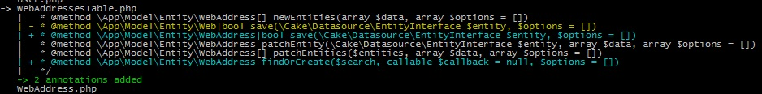

#  CakePHP IdeHelper Plugin

IdeHelper plugin for CakePHP applications.

This development branch targets CakePHP 6. Stable 2.x releases support CakePHP 5.
The published documentation covers the stable CakePHP 5 release. For this development branch, read the [branch documentation](docs/guide/index.md).

Start with [Installation](https://dereuromark.github.io/cakephp-ide-helper/guide/installation),
then follow [Getting started](https://dereuromark.github.io/cakephp-ide-helper/guide/getting-started).
Composer defines the supported dependencies. For older CakePHP versions see the
[version map](https://github.com/dereuromark/cakephp-ide-helper/wiki#cakephp-version-map).

## Features

The main idea is to improve IDE compatibility and use annotations to make the IDE understand the
"magic" of CakePHP, so you can click through the class methods and object chains as well as spot obvious issues and mistakes easier. The IDE will usually mark problematic code yellow (missing, wrong method etc).

This also improves compatibility with tools like [PHPStan](https://github.com/phpstan/phpstan).
Those can then follow the code easier and provide more valuable help.

- Add annotations to existing code (e.g. when upgrading an application) just like baking would to new code.
- Can run multiple times without adding the annotations again.
- It can also replace or remove outdated annotations.
- Works with your application as well as any loaded plugin.
- CI check support, hook it up just like the coding standards check.
- Set up as watcher and have live in-real-time annotations added/updated.

Supports annotations for:
- Models (Tables and Entities)
- Controllers (including prefixes like `Admin`) and Components
- View (AppView) and Helpers
- Templates (`.php` PHP template files including elements)
- Commands and Tasks
- ... and more

Supports code completion help for:
- Behaviors (property access on the BehaviorRegistry)

Supports IDE autocomplete/typehinting of (magic)strings as well as return types/values for:
- Plugins, Components, Behaviors, Helpers, Mailers
- Associations, Validation
- I18n Translation, Cache
- Elements and layouts
- Tables and their fields
- Route paths, Request/ENV, Connection
- ... and more (using PhpStorm meta file)

Supports better IDE usage with Illuminator tasks to enhance existing code:
- EntityFieldTask adds all entity fields as class constants for easier usage in IDEs

### IDE support
Annotations work in editors and static analyzers that understand PHPDoc.
PhpStorm and VS Code with Intelephense can also use the generated metadata.
See [IDE support](https://dereuromark.github.io/cakephp-ide-helper/guide/ide-support)
for setup links and indexing advice.

### Plugin with Annotator tasks
- [CakephpFixtureFactories](https://github.com/dereuromark/cakephp-fixture-factories) for Factory class usage through `@extends`.

### Plugins with meta file generator tasks
The following plugins use this plugin to improve IDE compatibility around factory and magic string usage:
- [Migrations](https://github.com/cakephp/migrations) for migration file writing (included in IdeHelper directly).
- [Queue](https://github.com/dereuromark/cakephp-queue) for `QueuedJobsTable::createJob()` usage.
- [Burzum/CakeServiceLayer](https://github.com/burzum/cakephp-service-layer) for `loadService()` usage.
- ... (add yours here)

### Plugins with Illuminator tasks
- [StateMachine](https://github.com/spryker/cakephp-statemachine) for syncing states from XML into PHP.
- ... (add yours here)

### More
More collections of useful tasks can be found in the [IdeHelperExtra plugin](https://github.com/dereuromark/cakephp-ide-helper-extra).

### Install, Setup, Usage
See the **[Documentation](https://dereuromark.github.io/cakephp-ide-helper/)** for details.

### Powered by

They are sponsoring my IDE for my FOSS work on this repository and beyond.

